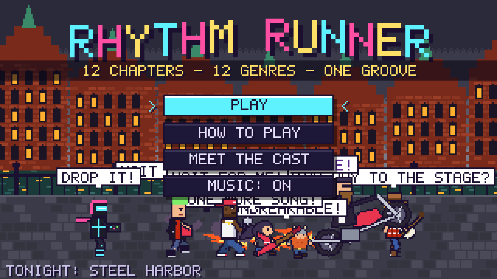
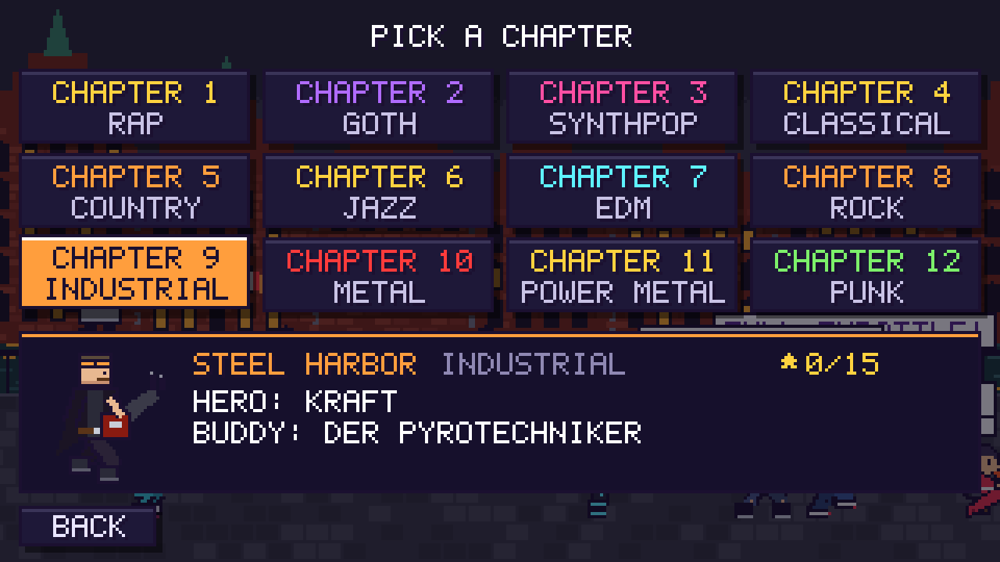
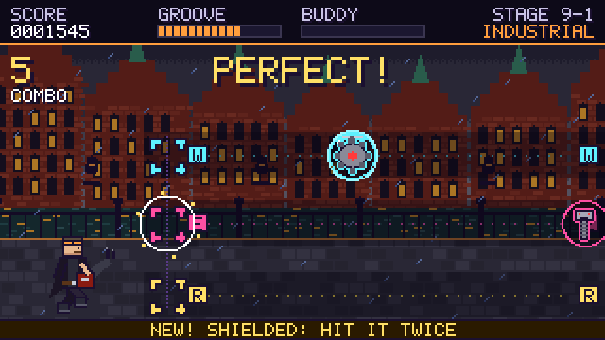
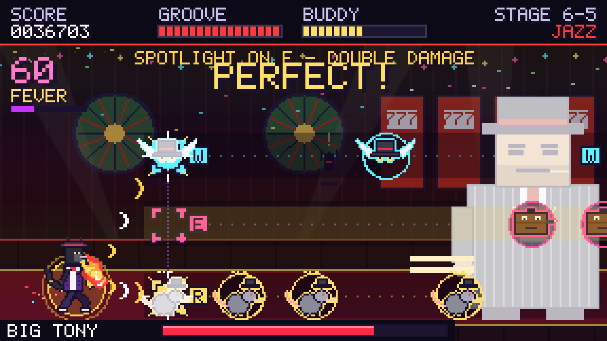

# Rhythm Runner

A pixel-art rhythm runner in twelve chapters, each with its own music genre, hero, buddy, worlds and bosses. Every song, sprite and comic in the game was generated by the scripts in this repository.



| | |
|---|---|
|  |  |
|  | |

## Play

Download the latest build from the [Releases](../../releases) page.

**Linux (AppImage)**

```bash
chmod +x RhythmRunner-*-x86_64.AppImage
./RhythmRunner-*-x86_64.AppImage
```

If it complains about FUSE, install `libfuse2` (`libfuse2t64` on Ubuntu 24.04 and later) or run it with `--appimage-extract-and-run`.
The game starts in fullscreen; F11 or Alt+Enter toggles it.

**In a browser**

Unzip `rhythm-runner-web-*.zip`, start a local web server in that folder and open it:

```bash
cd rhythm-runner-web
python3 -m http.server 8000
# then open http://localhost:8000
```

Opening `index.html` straight from disk does not work, because the game loads its chapter data and music with `fetch()`.

## How to play

| Key | Action |
|---|---|
| W / E / R | Hit the high, middle and ground lane |
| Space | Hit all three lanes |
| B | Call your buddy when its meter is full |
| Q | Kick your rival back (after a 12-hit streak) |
| P | Pause |
| Up / Down (map) | Audio offset calibration |
| C / J / S (map) | Outfits, jukebox, story comic |
| Esc (map) | Back to the title screen |

Hit enemies on the beat. Misses drain the groove meter; a full meter plus a 30 combo starts Fever (double score).
Each chapter has five stages: an intro stage, a rival race, a mini boss, a duet with a random hero from another chapter, and a boss fight.

## Chapters

| # | World | Genre | Hero | Buddy | Mini boss | Boss |
|---|---|---|---|---|---|---|
| 1 | Concrete City | Rap | The MC | DJ Subwoofer | Graffiti Golem | The Autotuner |
| 2 | Ravenmoor | Goth Rock | Goth Guitarist | The Reaper | Gargoyle | Countess Nocturne |
| 3 | Neon City | Synthpop | Neon Skater | Keytar Hero | Boombox Brute | The Mainframe |
| 4 | Grand Opera | Classical | Vivi | The 1812 Cannons | Grand Piano | Maestro Mortis |
| 5 | Dusty Gulch | Country | Banjo Belle | The Stampede | Tumbleweed Giant | The Iron Horse |
| 6 | Velvet District | Jazz | Sax Cat | The Big Band | The Bouncer | Big Tony |
| 7 | Bass Planet | EDM | Nova | The Bass Cannon | Wobble Bot | The Drop |
| 8 | Sunset Highway | Rock | Rock Hero | The Biker | Amp Wall | Amp Titan |
| 9 | Steel Harbor | Industrial | Kraft | Der Pyrotechniker | Die Presse | Der Eisenkran |
| 10 | Molten Keep | Metal | Iron Dwarf | The Boar King | Troll Drummer | Magma Drake |
| 11 | Sky Citadel | Power Metal | Steel Bard | The Headbangers | Minotaur | Storm Titan |
| 12 | Riot Street | Punk | Spike | The Cart Crew | Mall Cop Mech | CEO Corporatron |

Chapters are ordered from the calmest music to the most aggressive.

## Boss fights

Every boss fight draws three mechanics from a pool of 30, using a difficulty budget that grows from chapter to chapter: gentle tricks early on, harsh ones (reversed keys, mirror arena, tempo surge and more) in the late game. See [docs/MECHANICS.md](docs/MECHANICS.md) for the full list.

## Building from source

Requirements: Python 3.10 or newer, Node.js 20 or newer with npm, and ffmpeg (only needed to regenerate music).

```bash
git clone https://github.com/Mladen642/rhythm-runner.git
cd rhythm-runner
python3 -m pip install -r tools/requirements.txt
```

The music is not stored in git. Download `rhythm-runner-web-*.zip` from Releases and copy its `assets/audio/*.mp3` files into `tools/`.

```bash
cd tools
python3 app_build.py     # chapter data, images, music and engine into build/web
python3 app_start.py     # the start page, build/web/index.html
cd ../build/web && python3 -m http.server 8000     # play in a browser

cd ../../desktop
npm install
npm start                # run the desktop app
npm run dist             # build the AppImage into desktop/dist
```

See [tools/README.md](tools/README.md) for the content pipeline (music, art, charts and comics) and [docs/ARCHITECTURE.md](docs/ARCHITECTURE.md) for how the pieces fit together.

## Project layout

```
tools/            content pipeline (Python) and the source data it produced
  chapter_engine.html   the game engine
  app_build.py          builds the playable game into build/web
desktop/          Electron shell and AppImage packaging
vendor/mespeak/   bundled speech engine for character voices (GPL-3.0)
docs/             mechanics reference, architecture notes, release steps, screenshots
```

## License

Rhythm Runner is free software, licensed under the GNU General Public License, version 3 or (at your option) any later version. See [LICENSE](LICENSE).

The bundled meSpeak speech engine (eSpeak compiled to JavaScript, by Norbert Landsteiner) is licensed under the GPL version 3; see [vendor/mespeak](vendor/mespeak). Electron and electron-builder are MIT-licensed.
